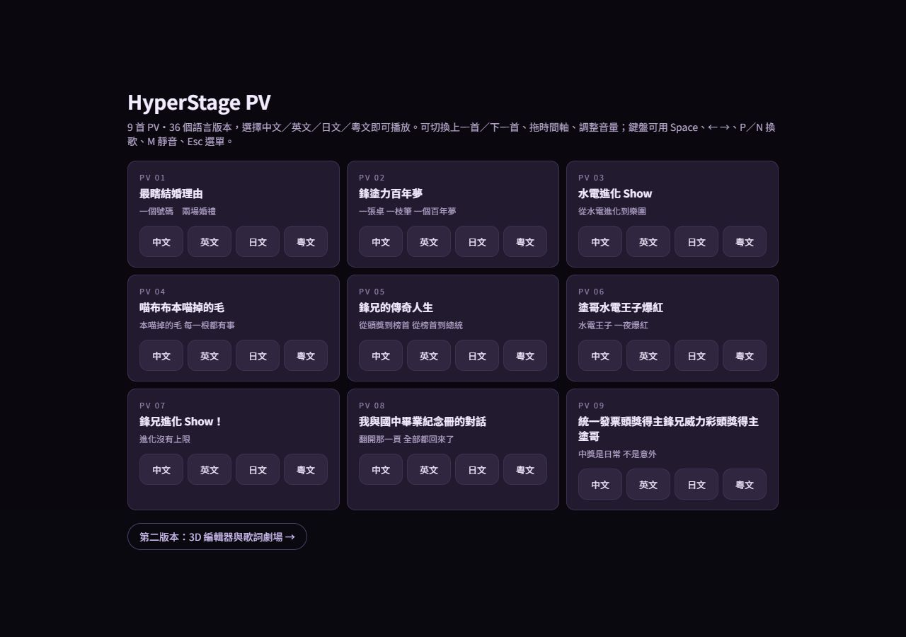

# NewEffects 四語版本驗證

來源：[goldshoot0720/NewEffects @ bfdfde8](https://github.com/goldshoot0720/NewEffects/commit/bfdfde814b2281fb4e93cafbb99ae9e995766faf)。來源檔案與音訊 SHA-256 見 [neweffects-import.json](neweffects-import.json)。

- 9 首 PV，各有中文、英文、日文、粵文，共 36 版；保留原有歌曲 ID 與 PV 01～09。
- 136 份來源檔案與目前 GitHub 提交一致，逐句原文、重唱與略唱依來源時間軸保存。
- 36 版 MP3 均在 Chromium 實際解碼，實際長度與來源相符；各版開頭、曲中與片尾可渲染，無頁面錯誤。
- PV 及歌詞劇場皆為 9 組歌曲、36 個語言按鈕；1280×900 與 375×667 選單按鈕至少 44px 高，未橫向溢出。
- 前後換歌依中文、英文、日文、粵文順序；劇場四人／五人歌曲切換正常。
- 頭獎英文生日字卡、五人配置、鋒兄 C 位、塗哥相鄰與喵掌姿勢保留；原版婚禮保留雙人互動。
- `npm test`：31 項通過。`npm run build`：通過。
- 本次更新網站播放資料，未另批次輸出 36 支 MP4；先前 Release 影片仍為當時的音源與時間軸。

